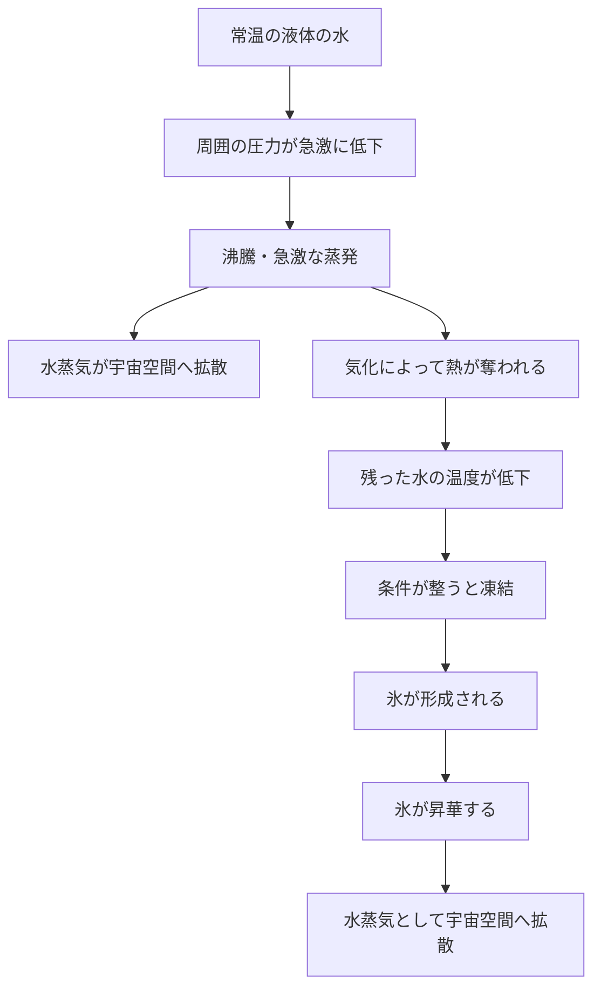

---
tags:
  - "科学/宇宙"
  - "科学/物理"
source:
  - "https://www.nist.gov/si-redefinition/kelvin/kelvin-present-realization?utm_source=chatgpt.com"
  - "https://sheffield.ac.uk/news/boil-freeze-bubble-crack-repeat-scientists-simulate-solar-systems-ice-volcanoes-lab?utm_source=chatgpt.com"
  - "https://pubs.rsc.org/en/content/articlelanding/2018/cp/c8cp05955a?utm_source=chatgpt.com"
  - "https://pmc.ncbi.nlm.nih.gov/articles/PMC13552893/?utm_source=chatgpt.com"
  - "https://agupubs.onlinelibrary.wiley.com/doi/10.1029/2025JE009236?utm_source=chatgpt.com"
created: "2026-11-03"
updated: "2026-11-03"
aliases:
  - "宇宙の真空環境で水はどうなるのか｜沸騰・凍結・昇華"
関連:
  - "[[宇宙では涙が流れない？]]"
  - "[[宇宙服なしで宇宙空間に放り出されたらどうなる？]]"
sort_yomi: "うちゅうのしんくうかんきょうでみずはどうなるのか"
status: "review"
---
# 宇宙の真空環境で水はどうなるのか｜沸騰・凍結・昇華

## 1. 概要

宇宙空間の真空に液体の水をさらすと、地球上では通常見られない現象が発生する。

**常温の水が沸騰し、その結果として冷却され、凍結することがある。さらに、形成された氷も昇華によって失われていく。**

この現象には、次の4つの物理的な仕組みが関係している。

1. **沸騰：** 圧力の低下によって水が急激に気化する。
    
2. **蒸発冷却：** 気化に必要なエネルギーが奪われ、水の温度が下がる。
    
3. **凍結：** 十分に冷却された水が氷になる。
    
4. **昇華：** 氷が液体を経ずに直接水蒸気になる。
    

ただし、これらが必ず順番に起こるわけではない。条件によっては、**沸騰と凍結が同時に進行する**ことも実験的に確認されている。

> [!IMPORTANT] 前提  
> 本記事は、宇宙船の外側にある極めて低圧の環境を主な対象とする。
> 
> 国際宇宙ステーション（ISS）の内部には空気と気圧が存在するため、水が常温で激しく沸騰することはない。
> 
> また、宇宙空間は完全な無ではなく、微量の粒子や放射線などが存在する。「完全な真空」は物理現象を考えるための理想化である。

---

## 2. なぜ真空では常温の水が沸騰するのか

### 2.1 沸点は圧力によって変化する

水の沸点は、常に100℃というわけではない。

**水は周囲の圧力が低くなるほど、低い温度で沸騰する。**

例えば、次のような関係がある。

|周囲の圧力|水の沸騰する温度|
|---|---|
|約101.3kPa（1気圧）|約100℃|
|約2.34kPa|約20℃|
|約0.61kPa|約0.01℃（三重点付近）|

水が沸騰するのは、水の飽和蒸気圧が周囲の圧力に達するためである。

したがって、20℃の水でも、周囲の圧力を約2.34kPaより低くすれば、沸騰が起こり得る。

### 2.2 水の三重点とは

水には、**固体・液体・気体の3つの状態が平衡状態で共存できる「三重点」**が存在する。

純水の三重点は、およそ次の条件である。

- 温度：0.01℃
    
- 圧力：約611.657Pa（約0.006気圧）
    

この圧力より低い環境では、通常の平衡状態として液体の水は安定して存在できない。

そのため、宇宙空間のような極めて低圧の環境に液体の水を置くと、急激な気化や冷却などが進行する。

なお、三重点を下回る圧力でも、液体の水が一瞬で完全に消えるわけではない。状態変化には有限の時間が必要である。

---

## 3. 水が沸騰しながら凍結する仕組み

### 3.1 第1段階：急激な気化が始まる

例えば、20℃の水を含んだタオルを真空にさらしたとする。

圧力が急激に下がると、水の表面や内部から水蒸気が発生する。

このとき、露出している水は激しく気化し始める。

### 3.2 第2段階：気化熱によって冷却される

水が液体から気体へ変化するには、エネルギーが必要である。

これを**気化熱**という。

水が気化するとき、そのエネルギーは残った水や周囲の物体から供給される。

その結果、液体の水は熱を失い、温度が低下する。

これは、汗が蒸発すると皮膚が涼しく感じられる現象と基本的に同じ仕組みである。

### 3.3 第3段階：残った水が凍結する

蒸発冷却が進み、水の温度が十分に下がると、氷が形成される。

ただし、水は0℃になった瞬間に必ず凍結するとは限らない。

0℃未満でも液体のまま存在する**過冷却**という状態があり、実際の凍結開始温度は条件によって異なる。

また、水の表面が氷になっても、内部に液体が残る場合がある。

2025年にシェフィールド大学などが紹介した低圧実験では、**水の表面に氷が形成される一方、その下では液体の水が沸騰し続ける**現象が観察された。

つまり、沸騰と凍結は必ずしも交互に起こるのではなく、同時に進行し得るのである。

### 3.4 第4段階：形成された氷が昇華する

真空中で氷が形成されても、そのまま永久に残るとは限らない。

氷の表面では、水分子が直接気体となって離れていく。

この現象を**昇華**という。

昇華は0℃以下でも起こり得る。

ただし、昇華速度は氷の温度、周囲の圧力、受け取る熱エネルギー、表面積などによって大きく異なる。

---

## 4. 水の状態変化を図で整理

> [!NOTE] 図の読み方  
> この図は、現象の因果関係を単純化したものである。
> 
> 実際には、氷が形成されている間も液体の沸騰が続くことがあり、すべての水が必ず凍結を経由するとは限らない。

---

## 5. 沸騰・凍結・昇華にはどれくらいの時間がかかるのか

水の状態変化に必要な時間は、**水滴の大きさや実験条件によって、ミリ秒から数時間以上まで変化する。**

実際の研究で報告された結果を整理する。

|実験対象|観察された現象|所要時間|
|---|---|---|
|直径49µmの微小水滴|蒸発冷却による凍結|約7.0〜7.9ミリ秒|
|半径3mmの水滴|室温から約0℃まで冷却|約50秒|
|同じ半径3mmの水滴|過冷却状態から凍結開始|約110秒後|
|低圧環境に置かれた比較的大量の水|表面の大部分に薄い氷が形成|数分以内|
|約0.1mLの純水から作った氷|低温・高真空下で完全に昇華|約4時間53分〜7時間7分|

### 5.1 微小水滴はミリ秒単位で凍る

2018年、九州大学などの研究チームは、真空中に生成した直径49〜71µmの純水の水滴を調査した。

直径49µmの水滴では、生成から約7.0〜7.9ミリ秒の間に凍結が進行した。

これは、**1秒の100分の1にも満たない時間**である。

ただし、これは微小水滴について得られた結果であり、数mm以上の水滴にそのまま当てはめることはできない。

### 5.2 数mmの水滴では数十秒〜数分かかる

2026年、アムステルダム大学などの研究チームは、減圧環境で水を凍らせる研究を発表した。

半径約3mmの水滴を用いた実験では、次の結果が得られた。

- 約50秒後：室温から約0℃まで冷却
    
- 約110秒後：過冷却状態から凍結が始まる
    

実験時の圧力は約2〜3mbar（約200〜300Pa）であった。

ただし、この実験では大気圧から減圧する工程も時間に含まれている。

したがって、**最初から宇宙空間の真空に放出した水滴が、必ず110秒後に凍るという意味ではない。**

### 5.3 氷の昇華には数時間かかる場合もある

2025年の『Journal of Geophysical Research: Planets』掲載論文では、約0.1mLの純水を凍らせた試料の昇華速度が調査された。

約−60℃、極めて低い圧力という条件では、純水の氷が完全に昇華するまで、およそ4時間53分〜7時間7分かかった。

これは、**真空に置かれた氷が、必ず瞬時に消えるわけではない**ことを示す実験例である。

ただし、日光を受ける宇宙空間の氷について、そのまま同じ時間を適用することはできない。

---

## 6. なぜ水滴の大きさで変化速度が違うのか

重要なのは、**体積に対する表面積の割合**である。

小さな水滴ほど、水の量に対して外部に露出している表面積の割合が大きくなる。

そのため、水滴全体から熱や水分が移動しやすく、冷却が急速に進みやすい。

一方、大きな水の塊では、内部から表面まで熱が移動する必要があり、冷却に時間がかかる。

さらに、タオルに染み込んだ水では、繊維への付着や熱の供給も影響する。

したがって、**微小水滴・大きな水滴・濡れたタオルの水を同じ速度で扱うことはできない。**

---

## 7. 宇宙空間で濡れたタオルを絞った場合

実際の宇宙空間に濡れたタオルを直接さらした場合、以下の現象が予想される。

1. 表面に露出した水が急激に気化する。
    
2. 気化によって残った水やタオルが冷却される。
    
3. 条件が整えば、繊維に保持された水の一部が凍結する。
    
4. 形成された氷が、時間とともに昇華する。
    

ただし、次の点に注意する必要がある。

- すべての水が氷になるとは限らない。
    
- 絞った際に分離した水滴と、繊維に保持された水では挙動が異なる。
    
- 太陽光を受ける場合と日陰では、受け取る熱エネルギーが異なる。
    
- タオル自体の温度や材質も変化速度に影響する。
    

> [!WARNING] 実験結果と予測の区別  
> 本記事で紹介した時間データは、水滴や氷を使用した個別の実験結果である。
> 
> 実際の宇宙空間で濡れたタオルを絞った場合について、沸騰・凍結・昇華に要する時間を直接測定したデータではない。

---

## 8. まとめ

宇宙空間の真空に水をさらすと、圧力低下によって常温でも激しい気化が起こり得る。

気化によって残った水から熱が奪われ、温度が十分に下がれば凍結する。

さらに、形成された氷も昇華によって失われていく。

ただし、これらは単純な一方向の変化ではない。

液体の沸騰と凍結が同時に起こったり、凍結した水が長時間残ったりする場合がある。

> [!IMPORTANT] 重要なポイント  
> **真空では、水が沸騰することと凍結することは矛盾しない。**
> 
> 沸騰によって水が熱を失うため、残った水が凍結するのである。
> 
> また、状態変化の速度は水の大きさや温度、圧力、熱の供給条件に左右される。すべての水が瞬時に凍るわけではない。

---

## 関連ノート

- [[宇宙では涙が流れない理由｜表面張力と蒸発の仕組み]]
    
- [[宇宙服なしで宇宙空間に放り出されたら｜真空が人体に与える影響]]
    

---

## 出典・参考資料

### 1. 米国国立標準技術研究所（NIST）

**Kelvin: Present Realization**

水の三重点と、その温度・圧力について解説した公式資料。

[NIST公式資料](https://www.nist.gov/si-redefinition/kelvin/kelvin-present-realization?utm_source=chatgpt.com)

### 2. 英国シェフィールド大学

**Boil, freeze, bubble, crack, repeat! Scientists simulate the Solar System's 'ice volcanoes' in the lab**

低圧環境において、水が沸騰しながら凍結する現象を調査した研究の公式解説。

[シェフィールド大学公式発表](https://sheffield.ac.uk/news/boil-freeze-bubble-crack-repeat-scientists-simulate-solar-systems-ice-volcanoes-lab?utm_source=chatgpt.com)

### 3. Physical Chemistry Chemical Physics｜2018年

**Freezing of micrometer-sized liquid droplets of pure water evaporatively cooled in a vacuum**

直径49〜71µmの水滴を使い、真空中での蒸発冷却と凍結速度を検証した原著論文。

DOI：10.1039/C8CP05955A

[原著論文](https://pubs.rsc.org/en/content/articlelanding/2018/cp/c8cp05955a?utm_source=chatgpt.com)

### 4. Proceedings of the National Academy of Sciences｜2026年

**Three-dimensional printing of ice structures via evaporative cooling in vacuum**

半径3mmの水滴を使用し、減圧下での冷却・凍結の時間変化を測定した原著論文。

DOI：10.1073/pnas.2608173123

[原著論文・全文](https://pmc.ncbi.nlm.nih.gov/articles/PMC13552893/?utm_source=chatgpt.com)

### 5. Journal of Geophysical Research: Planets｜2025年

**Microstructure Controls Sublimation Timescales of Exposed Salt-Rich Ices on Icy Worlds**

純水の氷や塩を含む氷を使用し、低温・高真空環境での昇華時間を調べた原著論文。

DOI：10.1029/2025JE009236

[原著論文](https://agupubs.onlinelibrary.wiley.com/doi/10.1029/2025JE009236?utm_source=chatgpt.com)