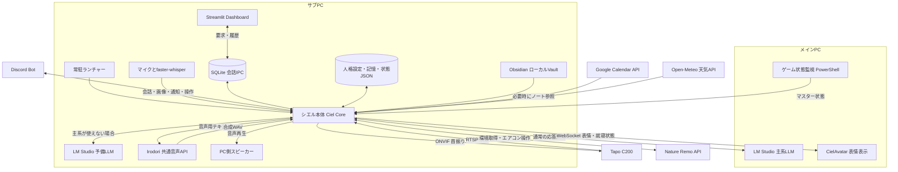

---
aliases:
  - Ciel構成図
  - シエル構成まとめ
tags:
  - シエル
  - システム構成
  - 運用
updated: 2026-10-07
---

# シエルの現在構成と動作

シエルは、**サブPCで動くPython本体を中心に、メインPCのLLM、カメラ、マイク、音声合成、Discord、Dashboard、Obsidianなどを連携させたAIペットシステム**。

通常はメインPCのLM Studioで応答を生成し、サブPCのIrodoriで音声を作って、サブPC側のスピーカーから話す。会話の人格・感情・記憶・機器操作はシエル本体が管理する。

> [!info] このノートの確認範囲
> 2026年10月7日に、サブPCの現行ソース、起動スクリプト、設定、更新中の状態ファイル、ローカルAPIを確認して作成。
> 設定として有効な機能と、その場で動作を確認した機能は区別する。メインPC側のアバター描画や、全機器の実操作を今回再試験した資料ではない。

## 1. 全体構成



### PCごとの分担

| 場所 | 主な担当 |
|---|---|
| サブPC | シエル本体、常駐ランチャー、マイク認識、カメラ映像処理、Irodori、Dashboard、記憶保存、外部サービス連携、予備LLM |
| メインPC | 通常使用するLLM、CielAvatar、ゲームの起動・最前面状態の監視 |
| Tapo C200 | 室内映像の配信、パン・チルト動作 |
| スマートフォン等 | Discord、または到達可能なネットワーク経由のDashboardで会話・操作 |

## 2. 使用しているアプリ・コンポーネント

| アプリ／コンポーネント        | 役割                | 現在の使い方                                  |
| ------------------ | ----------------- | --------------------------------------- |
| Windows＋Python     | 実行基盤              | サブPCの `.venv` でCoreとDashboardを実行        |
| LM Studio          | 会話・画像の応答生成        | メインPCを主系、サブPCを予備系として使用                  |
| Irodori-TTS        | 音声合成              | シエルとラファエルが同一の常駐モデル／APIを共有               |
| Gradio             | IrodoriのWebUIとAPI | `tools/irodori_webui.py` がシエル用の合成APIを追加 |
| faster-whisper     | マイク音声の文字起こし       | `small`、CPU、`int8`、日本語認識                |
| sounddevice        | マイク取得             | サブPCのRealtekマイクを使用                      |
| OpenCV             | カメラ映像取得・画像処理      | Tapo C200のRTSP映像を取得                     |
| Ultralytics YOLO   | 人物検出              | `models/yolov8n.pt` で映像内の人物を検出          |
| ONVIF／onvif-zeep   | カメラ操作             | 左右上下の移動、停止、ホーム位置管理                      |
| Discord／discord.py | チャット・遠隔操作・通知      | 通常会話、添付画像、起動停止、状態通知など                   |
| Streamlit          | Dashboard         | チャット、画像送信、状態確認、機能の切り替え、記憶の閲覧・整理         |
| SQLite             | CoreとDashboardの連絡 | 要求、返信履歴、画像添付、サービス状態を保存                  |
| Obsidian           | ローカルノート参照         | Vault内のMarkdownを必要時に読み取る                |
| Tailscale          | PC間・端末間の接続        | 主系LLMとゲーム状態受信にTailscaleアドレスを使用          |
| Nature Remo        | 室内環境・家電連携         | 温湿度等の取得、エアコン設定の提案と明示的操作                 |
| Google Calendar    | 予定・仕事前の準備通知       | 読み取り専用OAuthで予定を取得                       |
| Open-Meteo         | 天気情報              | 仕事前の通知に気温・降水確率から助言を追加                   |
| CielAvatar         | シエルの見た目の表示        | メインPC側の表示アプリへ表情・就寝状態を配信する構成             |
| PowerShell監視スクリプト  | ゲーム状態の連携          | メインPCでゲームの起動と最前面状態を調べ、サブPCへ送信           |

主要な音声認識依存は `faster-whisper==1.2.1` と `av==18.0.0`。Core用の依存は `requirements.txt` と `requirements-runtime-lock.txt` に記録されている。

Irodoriは `tools/irodori-tts/.venv` という別のPython環境を使う。Core側はAPIで音声を依頼するため、Irodoriの推論環境をCoreへ直接組み込む構造ではない。

## 3. LLMとPC間通信

### 現在のモデル設定

| 系統 | 実行場所 | API接続先 | モデルID |
|---|---|---|---|
| 主系 | メインPC | `http://100.98.82.97:1234/v1` | `qwen3.8-27b-turbo-fable-cold-fusion` |
| 予備系 | サブPC | `http://127.0.0.1:1234/v1` | `huihui-qwen3.5-9b-abliterated` |

主系は画像用モデルの個別指定がないため、会話と画像に同じモデルIDを使う。予備系も会話・画像ともに上記モデルを指定している。

設定は `data/llm_config.json`。接続・要求の組み立ては `modules/ciel_llm.py` と `modules/llm_client.py`、切り替えは `modules/llm_failover.py` が担当する。LM StudioのOpenAI互換APIへ文章や画像を渡す。

### メインPCが使えないとき

1. 主系が利用できない場合、サブPCの予備LLMへ切り替える。
2. 同じCoreの人格・会話履歴・記憶を使い、文字で会話を続ける。
3. 予備系では `reasoning_effort: none` を指定してThinkingを無効にする。主系にはこの指定を追加しない。
4. 予備系の間はシエル・ラファエル・内部対話を含め、TTS生成と音声再生を抑制する。
5. 主系の復帰を定期確認し、復帰確認後に主系へ戻して音声を再開する。再確認間隔の設定値は30秒。

> [!note] モデル名の確認場所
> モデルのファイル名とAPI上のモデルIDは一致するとは限らない。現在の指定は `data/llm_config.json` が基準。旧起動ノートにある `qwen3.5-9b.gguf` は、現在の予備系に指定されたIDとは異なる。

### 接続先一覧

| 用途 | 接続先／待受先 | 補足 |
|---|---|---|
| 主系LLM | `100.98.82.97:1234` | メインPC、Tailscale経由 |
| 予備LLM | `127.0.0.1:1234` | サブPC内 |
| Irodori | `127.0.0.1:7861` | サブPC内、WebUIと共通合成API |
| Dashboard | `0.0.0.0:8501` | 全インターフェースで待受。実際の到達可否は通信・Firewall設定による |
| ゲーム状態受信 | `100.125.235.26:8766` | サブPCのTailscale側HTTP。許可元はメインPCのTailscaleアドレス |
| アバター状態配信 | `192.168.0.18:8766` | サブPCの家庭内LAN側WebSocket。許可先は `192.168.0.12` |
| カメラONVIF | `192.168.0.19:2020` | Tapo C200の操作 |
| カメラRTSP | Tapo C200のRTSP接続設定 | 認証情報を含むURLのため、このノートには転記しない |

ゲーム状態受信とアバター配信は同じ8766番でも、待受IPとプロトコルが異なる別機能。アバター配信は家庭内LANに限定した設定になっている。

## 4. 会話が動く流れ

### 通常の会話

1. マイク・Discord・Dashboardなどから入力を受ける。
2. Coreが、通常会話か、就寝・カメラ・家電・システム操作などの命令かを判定する。
3. 通常会話なら、固定キャラクター設定、現在の感情・欲求、関連記憶、最近の会話を組み合わせる。
4. 必要な場合にObsidianの抜粋や画像を追加し、LM Studioへ応答生成を依頼する。
5. 返答本文と音声・表情用の情報を取り出す。
6. 入力元に応じて文字で返し、音声が許可されていればIrodoriで合成・再生する。
7. 会話履歴や感情・記憶を更新し、Dashboard用の状態も保存する。

操作要求は専用の解析・処理へ渡す。LLMが自由に任意の機器操作を実行する構造ではない。

### マイクから話す

`サブPCのマイク → sounddevice → 発話区間の録音 → faster-whisper → 認識文字列 → Core`

呼びかけ、音声コマンド、通常会話の経路がある。シエルの音声を自分で拾わないよう、TTS中と再生終了後約1.5秒は入力を抑制する。

Coreは `start_voice_input_thread(..., enabled=True)` で認識を開始する。補助設定ファイルやモジュール単体の初期値が `false` でも、それだけではCoreの音声入力が無効とは判断できない。確認時の状態ファイルではマイク取得と認識モデルのロードが有効だった。

### Dashboardから話す

`ブラウザー → ciel_dashboard.py → data/conversation.sqlite3 → Core → SQLiteの返信履歴 → ブラウザー`

Dashboard自身が別の人格やLLMで回答するのではなく、既存のCoreへ会話を依頼する。画像もIPCへ保存してCoreへ渡す。Dashboardの会話返信はDiscordへ転送しない。

画面にはチャット・画像送信に加えて、概要、現在状態、シエル制御、デバッグ、性格、記憶、最近の会話、Raw表示がある。

### Discordから話す

`Discordの指定チャンネル → Bot → Core → 同じ会話・記憶処理 → Discordへの返信`

添付画像は検証・正規化して画像会話へ渡す。システム制御は認可とコマンド判定を通す。本体停止中は常駐ランチャーがDiscordで起動指示を待ち、本体稼働中はCore側がDiscordを担当する。

## 5. 映像・音声・アバター

### カメラを見る・動かす

- Tapo C200の映像をRTSPで取得する。
- YOLOで人物を検出し、在席判断の材料にする。人物検出は個人の本人確認ではない。
- 観察会話や「見て」などの要求では、画像をLLMへ渡して解釈する。
- モニター注視では、カメラ映像の指定領域を切り出して観察する。メインPCの画面を直接キャプチャする方式とは異なる。
- 手動の左右上下移動・停止・ホーム復帰はONVIFで行う。
- ホーム位置は `data/ai_pet_ptz_state.json` に保存し、復帰時はカメラの位置・停止状態を確認する処理を持つ。

現在は**自律的なカメラ移動の全体スイッチがOFF**。巡回、在席中のちら見、マスター探索も保存設定ではOFF。映像取得・観察会話と、カメラを自動で動かす機能は別に制御される。

### シエルとラファエルの音声

現在のTTS選択は `data/tts_engine.json` の `irodori`。

| 項目 | 現在の構成 |
|---|---|
| 合成モデル | `Aratako/Irodori-TTS-v4.1-Small` |
| 推論設定 | モデル・コーデックともCUDA、BF16 |
| 共通API | `http://127.0.0.1:7861` の `ciel_synthesize` |
| シエルの参照音声 | `assets/voice/irodori_ciel_reference/iuno-Middle-Ref_part01.wav` |
| ラファエルの参照音声 | `C:\Users\mokus\Desktop\GPT_Create\Raphael_ref\output` のWAV |
| 再生場所 | サブPC側の音声出力 |

APIへ話者を指定し、同じモデルで参照音声を切り替える。シエルの感情情報は音声APIへ渡す段階で付与し、Discordや保存履歴には自然な返答本文を残す。ラファエルにはシエル用の感情タグを追加しない。

Tapoの内蔵スピーカーへシエルの合成音声を送る経路ではない。

### CielAvatarとの連携

CoreからWebSocketで発話の表情と `sleep_mode_enabled` を配信する。メインPC側にはQtクライアント等の接続部品を組み込む設計。

就寝モードは一時的な `sleepy` 表情と別の状態として扱う。アバター接続が失敗してもCoreの会話処理は継続する。

サブPC側の配信設定は有効だが、**このノートの調査ではメインPCの描画・瞬き・閉眼・ログオン起動まで確認していない**。

## 6. 人格・記憶・自律行動

### 固定の人格と学習データ

| 種類 | 主な保存場所 | 内容 |
|---|---|---|
| 作者が設定したキャラクター | `assets/ciel_character_profile.json` | シエル自身の固定設定 |
| 話し方の共通ルール | `modules/ciel_character.py` など | 一人称「私」、やわらかい自然な日本語、通常・画像会話の口調 |
| 会話と長期的な状態 | `ai_pet_memory.json` | 会話履歴、重要事項、長期記憶、エピソード記憶、コア記憶、日記、感情、興味、成長傾向 |
| Dashboard等の会話履歴 | `data/conversation.sqlite3` | 入力元付きの履歴、会話要求、処理状態、イベント |
| 表示用の現在状態 | `data/ai_pet_state.json` | 感情・欲求・在席・マイク・LLM経路・実行状態など |
| 機能のON／OFF | `data/ai_pet_control.json` | 就寝、自律発話、内部対話、カメラ、家電などの制御 |

固定キャラクター設定と会話から蓄積する記憶を分けている。関連する記憶を選んで会話へ渡し、バックグラウンドの記憶処理で会話要約やエピソード整理などを行う。

### 自律発話

在席や時間経過、感情・欲求、映像、回想などを材料に発話する。固定文とLLMによる生成を組み合わせ、話題の繰り返しや同じ内容の連発を抑制する。

現在の保存設定では、自律発話、回想イベント、話題疲労による繰り返し抑制、モニター注視が有効。ただし就寝やマスター状態、会話中などの条件によって実行を抑制する。

### シエルとラファエルの内部対話

`ciel_internal_dialogue.py` が担当する。

- シエル：好奇心、寂しさ、楽しさ、思い出、雑談などの感情担当。
- ラファエル：状態分析、記憶参照、室内環境分析、助言などの分析担当。
- 現在の内部対話エンジンは、条件に合う会話テンプレートを選び、状態値を反映して発話を組み立てる。
- 2つの独立したLLMが常時相談し合う仕組みではない。
- 再生時は話者ごとに音声を切り替え、必要に応じて先の発話を合成して待ち時間を減らす。

内部対話の保存設定はONだが、マスターとの会話中、TTS中、就寝中、制限状態などでは抑制される。

### マスター状態による制御

`modules/master_state.py` が `HOME / AWAY / SLEEP / WORKING / GAMING / BUSY / IDLE` を管理する。手動指定はDashboardや `/state GAMING` などから行い、`/state AUTO` で自動判断へ戻す。

メインPCの監視スクリプトは約5秒ごとにゲームの起動・最前面状態を送る。最前面が30秒続くとGAMINGになり、別ウィンドウへ移って5分、ゲーム終了後10秒、または通信の鮮度が30秒を超えると解除する条件がある。

GAMING・WORKING・BUSY・AWAY・SLEEPでは自律発話や重い自律生成を抑制する。直接の会話要求は継続するが、AWAY・SLEEPでは音声を禁止してDiscord側への返信を使う。既存のおやすみモードは状態判定の最優先。

> [!note] 実装済みの制御と実行予定
> 状態に応じた発話・音声の制御は実装されている。一方、状態変化だけで照明を消す、PCを起動停止する、防犯を強化するなどの機器アクションは `dry_run` の実行予定として保存する段階。
> 人物が映らないだけでは外出確定にせず、自動AWAYの設定も現在はOFF。

## 7. Obsidian・予定・家電との連携

### Obsidian

`modules/obsidian_reader.py` が、既定で `D:\Second Brain` 内のMarkdownを読み取る。Vaultの場所は `CIEL_OBSIDIAN_VAULT` で変更できる。

- 「Obsidian」「ノート」「メモ」など、参照を求める会話で検索する。
- 関連するノートの本文から抜粋を作り、Coreの会話コンテキストへ追加する。
- 今日の予定をノートから聞かれた場合は、日本時間の `05_Daily/YYYY-MM-DD.md` を読む。
- 検索で同一内容の重複を除外する。
- 連携モジュールは読み取り専用。ノートの同期はObsidian側の仕組みに依存し、シエルは同期先のリモートへ直接アクセスしない。

### Google Calendarと天気

`modules/ciel_calendar.py` が読み取り専用OAuthでカレンダーを取得する。

「今日の予定」「明日の予定」などへ回答し、仕事に該当する予定には出発時刻・準備・持ち物の案内を追加する。現在は仕事開始の105分前から通知対象になり、移動時間15分＋到着余裕25分を使って出発時刻を計算する設定。

仕事前のルーチンは約60秒ごとに確認する。Open-Meteoから気温・降水確率を取得し、必要な助言を加える。通知先の保存設定はDiscordと音声の両方がONだが、実際の配信・再生はCoreの状態制御にも従う。

通知済み情報を `data/calendar_routine_state.json` に記録して、同じ予定への通知の重複を避ける。交通状況をリアルタイムに調べる機能はない。

### Nature Remo

`modules/nature_remo_client.py` がAPIで環境やエアコン状態を取得し、`data/nature_remo_state.json` に保存する。環境確認の既定周期は180秒。

温湿度等を会話や内部対話の材料にし、エアコン設定を提案する。「つけて」「消して」「冷房26度にして」などの明示的な操作要求は専用解析から実行する。

現在の保存設定では、環境取得、エアコン提案、エアコン実行がON。ただしマスター状態の `dry_run` に記録された機器操作予定とは別の経路。

## 8. 起動の仕組み

```text
メインPC／サブPCのLM Studioを準備
  ↓
サブPCの all_start.bat
  ├─ start_irodori_api.ps1
  │    └─ tools/irodori_webui.py
  │         └─ Irodori APIの準備完了を確認
  ├─ start_ciel_lmstudio.bat
  │    └─ ciel_launcher.py
  │         └─ ai_pet_brain.py
  └─ start_ciel_dashboard.bat
       └─ Streamlitで ciel_dashboard.py
```

`all_start.bat` はLM Studio自体を起動・モデルロードする処理を持たないため、両PCのLM Studioは先に準備する。現在はDashboardも一緒に起動する設定。

`start_ciel_lmstudio.bat` はLLMプロバイダーをLM Studioへ指定し、Core用 `.venv` でランチャーを起動する。TTSの選択は保存された `data/tts_engine.json` が優先される。

ランチャーは本体を子プロセスとして起動し、終了コード20を再起動要求として処理する。通常停止後はDiscordの起動指示を待つ。予期しないクラッシュ後の無条件自動再起動は現在OFF。

ゲーム監視とCielAvatarは、メインPC側で別に起動する。サブPCの `all_start.bat` からメインPCのこれらを自動起動する構成ではない。

詳細な操作手順は [[シエル起動手順書]] を参照。モデルIDは本ノートと現行設定を優先する。

## 9. ファイル・フォルダー構造

基点：`C:\Users\mokus\Desktop\Ciel`

```text
Ciel/
├─ all_start.bat                 一括起動
├─ ciel_launcher.py              常駐・起動停止・再起動管理
├─ ai_pet_brain.py               シエル本体／全体の統合
├─ ai_pet_voice_input.py         録音・発話検出・文字起こし
├─ ciel_dashboard.py             ブラウザーUI
├─ ciel_conversation_ipc.py      SQLiteによる会話IPC
├─ ciel_internal_dialogue.py     シエルとラファエルの内部対話
├─ ai_pet_memory.json            会話・長期記憶・感情など
├─ modules/                     LLM、家電、予定、人格、コマンド等
├─ data/                        設定・現在状態・SQLite・認証関連
├─ assets/                      固定人格設定・音声アセット
├─ models/                      YOLO・音声認識モデルなど
├─ avatar_link/                 アバター配信・クライアント接続部品
├─ tools/
│  ├─ irodori-tts/               Irodori本体・専用Python環境
│  ├─ irodori_webui.py           共通音声APIを追加した起動用コード
│  └─ main_pc_connection/        メインPCの監視スクリプト配布用
├─ .venv/                       Core／DashboardのPython環境
├─ debug/                       実行ログ・音声認識等の診断
├─ temp/                        合成音声・録音・一時データ
├─ backup/・backups/             記憶や変更前ファイルのバックアップ
├─ tests/                       隔離検証・回帰テスト
└─ artifacts/                   調査報告・配布部品・説明ノート
```

APIキー、Discord Botトークン、Google OAuth認証情報、カメラ認証情報、状態連携トークンの値はこのノートに含めない。再構築時にはコードとモデルだけでなく、対応する認証設定も必要。

## 10. 現行経路・残っている旧方式・確認状況

### 現行経路と旧方式

| 区分 | 内容 |
|---|---|
| 現在の標準LLM | LM Studio、メイン主系＋サブ予備系 |
| 現在の標準TTS | Irodori、シエル／ラファエル共通API |
| 残っているLLM旧方式 | Ollama、`ollama_manager_api.py`、旧モデル名・URL・関数名 |
| 残っているTTS別方式 | GPT-SoVITS、VOICEVOX、IndexTTS関連のコード・設定・起動ファイル |
| 別の本体 | `ai_pet_brain_yomi.py` 等のヨミ用ファイル。現在のシエル標準ランチャーの起動先ではない |

Coreに `ollama_generate()` などの旧名が残っていても、標準起動では内部でLM Studioの処理へ分岐する。ファイルやコードが残っていることと、現在それを常用していることは区別する。

`CODEBASE_STATUS.md` などの古い資料にはOllama＋GPT-SoVITS時代の構成が記載されているため、現行構成の判断には起動スクリプト・設定・実行状態を優先する。

### 作成時に確認した状態

| 対象 | 今回確認できたこと |
|---|---|
| Core | 表示用状態ファイルが約数秒以内に更新され、サービス記録はOnline |
| LLM経路 | Coreの状態報告は主系、モデルIDは本ノートの主系と一致、TTS抑制はfalse |
| 主系API | この調査プロセスからの直接GETは接続エラー。Coreの報告と合わせても、今回の直接疎通成功とは扱わない |
| 予備API | `/v1/models` がHTTP 200、設定された予備モデルIDを確認 |
| Irodori | `/config` がHTTP 200、`ciel_synthesize` APIの存在を確認 |
| Dashboard | healthがHTTP 200 |
| Discord | Coreのサービス記録はConnected。今回、新規メッセージ送信は実施していない |
| 音声入力 | Coreの状態報告は取得中、`small` 認識モデルはロード済み |
| 自律発話・内部対話 | 保存設定はON。今回の調査で強制発火はしていない |
| 自律カメラ動作 | 全体スイッチと巡回・ちら見・探索の設定はOFF |
| アバター | サブPCの配信設定はON。メインPCでの描画確認は未実施 |
| 予定・家電 | 設定と処理経路を確認。今回の新規API取得・通知・機器操作は未実施 |

この状態は作成時点の記録。通常会話・音声再生・カメラ移動を含む全機能の再検証結果を意味しない。
