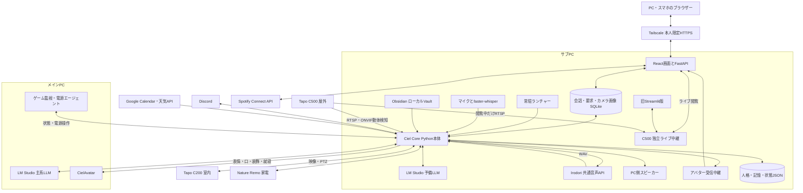

---
aliases:
  - シエル構成まとめ 2026-10-23
tags:
  - シエル
  - システム構成
  - 運用
created: 2026-10-23
updated: 2026-10-23
---

# シエルの現在構成と動作

**2026年10月23日版。** シエルは、サブPCのPython製「Ciel Core」を中心に、メインPCのLM Studio、音声認識・合成、室内／屋外カメラ、家電、ノート、予定表をつなぐAIペットシステム。

現在の主要な操作画面は、**Tailscale経由・本人認証付きHTTPSのReact版Dashboard**。会話の人格・記憶・機器実行は引き続きCoreが担当する。旧Streamlit版と初期React版も残っているため、入口を区別して使う。

> [!info] このノートの確認範囲
> 現在のコード、起動スクリプト、保存設定、更新中のCore状態、DBのサービス記録、HTTP応答を確認して作成した。
> 調査のための再起動・発話・Spotify操作・家電操作・カメラ移動は実施していない。設定上の対応と、今回実機で確認したことは分けて記載する。

## 1. 前回からの主な変更

比較元：2026年10月7日版の構成ノート。

| 項目 | 現在の構成・変更点 |
|---|---|
| 主系LLM | `qwen3.8-27b-humanlike-chat-2.0` へ変更。会話と画像に使用 |
| Dashboard | React＋TypeScript＋FastAPIの本人限定HTTPS版を追加。会話・状態・記憶・家電・PC・カメラなどを集約 |
| 屋外監視 | Tapo C500を追加。ONVIF動体検知、証拠画像保存、専用Discord通知、ライブ映像 |
| C200の動作 | 自律カメラ移動の全体スイッチと巡回の保存設定がON |
| アバター | 7表情、音源連動の3段階口パク、8種類の装飾、就寝状態。React画面もCoreの通知を受信 |
| 音声 | 長文の分割合成・WAV結合、登録済み固定フレーズ音声の再利用を追加 |
| 家電 | エアコンに加え、シーリングライトの電源・明るさ・色温度・プリセット操作 |
| メインPC | WoL起動、Ciel用モデルのVRAM解放／AI再開、スリープ／取消の実行経路を追加 |
| Obsidian | ノート名・aliases・見出し・本文を使う検索、関連情報の組み立て、記録済み音楽履歴の集計 |
| Spotify | DashboardからSpotify Connectを操作。曲情報、再生／停止、スキップ、シーク、音量 |
| ログイン | HTTPS版でブラウザーごとの認証を90日保持し、利用中に条件付きで延長 |

## 2. 全体構成とPCの分担



| 場所 | 担当するもの |
|---|---|
| サブPC | Core、ランチャー、Irodori、マイク認識、C200人物検出、C500監視、Dashboard API、ライブ中継、記憶保存、外部連携、予備LLM |
| メインPC | 主系LLM、デスクトップのCielAvatar、ゲーム状態監視、電源制御エージェント |
| ブラウザー | Reactの操作画面、アバター表示、カメラ閲覧。CoreとはAPI経由で連携 |
| Tapo C200 | 室内の視覚・人物検出用映像、シエルの首振り動作 |
| Tapo C500 | 屋外の動体検知・証拠画像用映像。複数視点などはTapo側で運用 |

## 3. 使用アプリ・実行環境

| アプリ／技術 | 役割 |
|---|---|
| Windows＋Python | Coreと各バックエンドの実行基盤 |
| LM Studio | ローカルLLMのAPI提供。メイン主系＋サブ予備系 |
| Irodori-TTS＋Gradio | シエルとラファエルが共用する常駐音声モデル・WebUI・合成API |
| faster-whisper＋sounddevice | マイク取得、発話区間の録音、日本語の文字起こし |
| OpenCV＋Ultralytics YOLO | C200映像の取得と `yolov8n.pt` による人物検出 |
| ONVIF／onvif-zeep | C200のPTZ操作、C500の本体動体検知イベント受信 |
| React＋TypeScript＋Vite | 新Dashboardの画面。ビルド済み資材を配信 |
| FastAPI＋Uvicorn | 新DashboardのAPI、認証、画面配信、WebSocket通知 |
| Motion＋OGL | 新Dashboardのアニメーション・感情に連動する表示など |
| Streamlit | 旧Dashboard。互換・切戻し用として残存 |
| Starlette＋MJPEG中継 | C500ライブ映像を新旧UIで共用 |
| SQLite | 会話IPC、要求・返信履歴、C500検知・画像、PC操作キュー |
| Discord／discord.py | チャット、画像会話、操作要求、監視・状態通知 |
| Tailscale | PC間通信と本人限定HTTPS入口 |
| Obsidian | ローカルノートの参照元 |
| Nature Remo | 温湿度などの取得、エアコンとシーリングライト操作 |
| Google Calendar／Open-Meteo | 予定取得、仕事前の準備・天気通知 |
| Spotify Web API | DashboardからSpotify Connect端末を操作 |
| Qt系アバター接続部品／PowerShell | メインPC側のアバター連携、ゲーム監視、電源エージェント |

Python環境は分離している。

- Core・旧Streamlit：`Ciel/.venv`
- Irodori：`Ciel/tools/irodori-tts/.venv`
- 新Dashboard API：`CielDashboardNext/.venv`
- 独立ライブ中継：別プロセスからCore側の環境と既存カメラ読取処理を使用
- React：Node／pnpmでビルドし、通常運用ではFastAPIから静的ファイルを配信

新Dashboard側の固定依存は、React `19.3.1`、TypeScript `7.0.2`、Vite `8.3.4`、FastAPI `0.143.3`、Uvicorn `0.54.0`。Nodeの開発サーバーを常時利用する構成ではない。

## 4. Dashboardと会話の経路

### 現在使う入口

| 入口 | 位置づけ |
|---|---|
| `https://desktop-ejcib0c.tail3b5040.ts.net/` | 本人限定HTTPSの現行React版。確認時APIバージョン `0.21.1` |
| `127.0.0.1:8782` | 現行React版を支えるローカルFastAPI。通常はHTTPS入口から使用 |
| `127.0.0.1:8780` | 残っている初期React版。確認時は `0.5.0` で、現行版とは機能が異なる |
| `127.0.0.1:8501` | 旧Streamlit版。直接アクセス保護・一部の書込制限があり、従来と同じ遠隔入口としては扱わない |
| `127.0.0.1:8786` | 新旧UIが共用する内部のC500ライブ中継。通常の閲覧入口ではない |

現行版はTailscale上の本人確認とマスターログインを組み合わせる。ブラウザーごとのログインを90日保持し、残り45日以下で所定のセッション確認を行うと90日へ延長する。保存はWindowsユーザー単位のDPAPI暗号化、ログアウトはそのブラウザーを失効させる。

### チャットの処理

`React画面 → FastAPIで認証・入力確認 → 既存SQLite IPCへ要求登録 → Core → LM Studio → 返信・履歴保存 → React表示`

画面やAPIが独立した人格で回答するのではなく、同じCoreの人格・記憶・感情を使う。文章と添付画像に対応し、要求IDで処理状況や再接続後の結果を確認する。Dashboard会話の返信を通常Discordチャットへ転送しない。

状態表示は保存済みJSON・DBを読み取る。変更をWebSocketで通知して対象部分を再取得し、切断時の再照合も行う。制御設定、記憶整理、期限付き生活状態などの書込は認可された要求としてCoreへ渡し、Coreが競合・版・期限を確認して実行する。

### 現行画面で扱うもの

- 文章・画像チャット、完成応答、履歴・要求状態
- 現在状態、感情、性格・成長傾向、最近の会話
- 記憶一覧、重要度変更、アーカイブ移動・復元
- おやすみ／おはよう、自律機能の制御、デバッグ登録、診断表示
- 有効時間付きの生活状態とAUTO解除
- エアコン・照明、メインPCの電源／VRAM操作
- C500のライブ映像、検知履歴・画像・監視設定
- Coreと同期するアバター、Spotify操作、操作ガイド

旧UIの記憶整理・生活状態・制御保存などにはガードが入っている。新UIの管理経路と旧UIの直接書込が競合しないようにした構成。

### マイクとDiscord

マイクは `sounddevice → 録音・発話検出 → faster-whisper small → 認識文字列 → Core`。CPU・int8、日本語で動作し、TTS中と再生後約1.5秒は自分の声を拾わないように抑制する。

Discordの通常会話・画像・管理コマンドもCoreへ入る。管理コマンドは共通の判定とユーザー認可を使う。本体停止中は常駐ランチャーが起動指示を待ち、本体稼働中はCore側がBot接続を担当する。

## 5. LLM・音声合成・フォールバック

### モデル

| 系統 | 実行場所 | API接続先 | 現在指定されたモデルID |
|---|---|---|---|
| 主系 | メインPC | `http://100.98.82.97:1234/v1` | `qwen3.8-27b-humanlike-chat-2.0` |
| 予備系 | サブPC | `http://127.0.0.1:1234/v1` | `huihui-qwen3.5-9b-abliterated` |

主系・予備系とも、会話と画像は各系統で同じモデルを指定。設定元は `data/llm_config.json`。`ciel_llm.py`、`llm_client.py`、`llm_failover.py` がAPI要求と経路切替を担当する。

通常テキスト用のプロンプト・生成設定は `modules/ciel_chat_prompt.py` に分離されている。通常応答の不要な短文化を避け、記憶や参照資料の抜粋上限とは区別している。

### 主系が利用できないとき

1. サブPCの予備モデルへ切り替え、同じCoreの履歴・人格・記憶で文字会話を継続する。
2. 予備系には `reasoning_effort: none` を指定する。
3. LLMに依存する会話・内部対話などの音声は通常抑制する。
4. ただし確定したシステム通知には独立した音声ポリシーがある。前回ノートの「例外なく全音声停止」とは異なる。
5. 主系を定期確認し、復帰確認後に通常経路へ戻る。再確認間隔の設定は30秒。

手動のVRAM解放中は `manual_vram` などの停止理由を管理し、主系の生成や復帰プローブも抑止する。単に通信が切れた場合と、意図的なAI停止を区別する。

### シエルとラファエルの音声

| 項目 | 現在の設定 |
|---|---|
| 選択エンジン | `data/tts_engine.json` の `irodori` |
| モデル | `Aratako/Irodori-TTS-v4.1-Small` |
| モデル／コーデック | CUDA、BF16 |
| 共通API | `127.0.0.1:7861`、`ciel_synthesize` |
| シエルの参照音声 | `assets/voice/irodori_ciel_reference/iuno-Middle-Ref_part01.wav` |
| ラファエルの参照音声 | `C:\Users\mokus\Desktop\GPT_Create\Raphael_ref\output` のWAV |
| 再生 | Coreが最終WAVをWindows側で同期再生 |

同じ常駐モデルを、話者と参照音声を切り替えて共有する。登録済みの固定フレーズは `modules/fixed_phrase_audio.py` から既存WAVを再利用し、毎回の生成を省く。

長文は読み・音声タグを含めたAPI入力を最大80文字に分割して合成し、WAVを結合する。返答本文そのものを80文字に切り捨てる処理ではない。

音声感情は本文と別の情報で持ち、Irodoriへ送るときに付与する。ラファエルへシエル用の感情タグを追加せず、画面・Discord・保存履歴には本文を残す。

シエルの声はサブPC側から出力する。Tapoの内蔵スピーカーやブラウザーへ音声を配信する経路ではない。

## 6. カメラはC200とC500で役割を分離

| 項目 | Tapo C200 | Tapo C500 |
|---|---|---|
| 用途 | 室内の視覚、在席判断、自律対話、首振り | 屋外の動体監視、証拠画像、ライブ閲覧 |
| 接続先 | `192.168.0.19` | `192.168.0.10` |
| 映像 | RTSPをCoreで受信 | 監視用RTSP `stream2` を継続受信 |
| 検知 | PC側YOLOの人物検出 | C500本体のONVIF動体検知 |
| PTZ | CoreからONVIFで操作 | CoreからPTZを操作しない。Tapo側の複数視点・追跡運用を維持 |
| 在席判断 | Coreの在席判断の材料 | C500検知だけでは外出・帰宅・在席を変更しない |
| 現在のAI画像解析 | 観察・画像会話で利用 | 監視通知画像のVisionはOFF |

### C200

OpenCVで映像を受信し、YOLOで人物を検出する。人物検出は個人識別とは異なる。画像会話・自律観察では静止画をLLMへ渡す。モニター注視はカメラ画像の指定領域の切り出しであり、メインPCの画面を直接取得する方式ではない。

**現在は自律カメラ移動の全体スイッチと巡回の保存設定がON**。ちら見・マスター探索は保存設定でOFF。会話、手動操作、ホーム条件などによる待機・抑制があるため、ONが常時移動を意味するわけではない。今回、実際に動かす再試験はしていない。

### C500の検知と画像

`C500本体の動体検知 → ONVIF PullPoint → Coreの監視ワーカー → 画像保存 → 専用Discord配送・Dashboard履歴`

- 通知起点は画像のYOLO判定ではなく、本体の動体検知イベント。
- 受信から1秒後以降の新しいフレームを初回画像にする。15秒以内に取れなければ画像取得不可として扱う。
- 60秒以内の再検知は集約し、動体ありを維持している場合は5分ごとに追加通知する。
- 継続中は10秒間隔や再検知時に経過画像を保存し、1イベント最大30枚を追加する。
- 送り先は専用のDiscord「監視カメラアラート」。通常チャットの配送先とは別。
- `vision_enabled=false` のため、現在は通知画像のLLM解析を行わない。検知・撮影・保存・通知は継続する。

初回・経過画像は `data/conversation.sqlite3` のBLOBとして保存。**最大30日、画像合計2,000,000,000バイト未満**を維持し、上限時は古い検知イベント単位で削除する。DBファイル全体のサイズ上限とは異なる。Discord側の既投稿やバックアップはこの削除対象ではない。

### C500のライブ映像

現在は `CielDashboardNext/relay/server.py` の独立中継を新旧Dashboardが共有する。閲覧開始時だけ追加のRTSP接続を開き、JPEGへ変換してMJPEGで配信する。実装上限は最大1280×720・10fps、音声なし。

監視用1本と閲覧用1本が別に存在し、複数画面の閲覧用接続は中継内で共有する。最後の閲覧終了で閲覧用接続を解放する。ライブ映像は連続録画として保存しない。

## 7. アバターの表示・口パク・装飾

Coreの `avatar_link` がWebSocketで配信する。待受は `192.168.0.18:8766`、現在の許可先はメインPC `192.168.0.12` とサブPC自身 `192.168.0.18`。

| 情報 | 処理 |
|---|---|
| 表情 | `neutral / smile / surprised / troubled / sleepy / shy / sad` の7種類 |
| 就寝状態 | `sleep_mode_enabled` を永続モードとして配信。一時的な眠そうな表情と分離 |
| 口パク | 最終再生WAVの音量を解析し、休止・半開き・開きの0／1／2を配信 |
| 装飾 | 驚き、疑問、汗、ハート、音符、省略、きらめき、睡眠の8種類 |

装飾は選択されたシエル発話の最終WAV再生の50%で一度だけ発火する。口パク・装飾は発話ID、連番、有効期限を使い、古い状態や再接続前の演出を残さない。ラファエルの音声ではシエルの口を開かず、シエル用装飾も発火させない。

表示先は2系統。

1. メインPCのCielAvatar：既存のデスクトップ表示アプリ。
2. React版Dashboard：FastAPIの受信専用共有中継から、認証付き `/api/avatar/ws` でブラウザーへ配信。

React版の上流接続は購読者がいる間だけ1本を共有する。切断・非表示・期限切れで口と装飾を解除する。ReactのBall表示が参照する持続的な感情と、発話ごとのアバター表情は区別される。

今回確認したのは配信・同期機能の設定とAPI上の有効化。実際の音声と口の表示遅延、メインPCアバターの描画は今回再検証していない。

## 8. 人格・記憶・Obsidian

### 固定設定と変化するデータ

| 保存場所／処理 | 内容 |
|---|---|
| `assets/ciel_character_profile.json` | 作者が定義した固定のキャラクター設定 |
| `modules/ciel_character.py`、`ciel_chat_prompt.py` 等 | 人格・話し方と各会話経路のプロンプト |
| `ai_pet_memory.json` | 会話、長期記憶、エピソード／コア記憶、日記、感情・欲求、興味、成長傾向 |
| `data/ai_pet_state.json` | UI用の現在状態、LLM経路、マイク、PTZ、環境、管理機能の状態 |
| `data/ai_pet_control.json` | 就寝、自律発話、内部対話、カメラ、家電などの保存設定 |
| `data/conversation.sqlite3` | 会話要求・返信・画像・イベント・サービス状態・C500画像 |

会話時に関連記憶を選んでLLMへ渡し、バックグラウンドの記憶処理で要約やエピソード整理を行う。Reactの記憶整理はCoreへ依頼し、重要度変更・アーカイブ・復元の前に版や競合を確認し、変更前の記憶を退避する。

### 自律発話と内部対話

自律発話は在席、時間、感情・欲求、映像、回想などを材料に、固定文とLLM生成を使い分ける。話題疲労や直近履歴で同じ内容の繰り返しを抑える。

`ciel_internal_dialogue.py` は、感情担当のシエルと分析担当のラファエルの対話を、状態に合うテンプレートから組み立てる。2つの独立LLMが常時議論する方式ではない。会話中・就寝中などには抑制する。

### Obsidian参照

既定Vaultは `D:\Second Brain`。`CIEL_OBSIDIAN_VAULT` で変更できる。連携自体は読み取り専用。

`参照を求める質問 → ノート検索・関連項目の組立 → 抜粋 → Coreのプロンプト → LLMの回答`

- `obsidian_reader.py` と `obsidian_index.py` がノート名・aliases・見出し・本文を使って検索する。
- **キーワード検索型のRAG**であり、現在のこの経路にベクトルDBや意味検索モデルは使っていない。
- 通常の参照コンテキストは既定で最大2,400文字。関連リンク等の情報も予算内で組み立てる。
- 今日の予定をノートから求められた場合は、日本時間の `05_Daily/YYYY-MM-DD.md` を使う。
- 音楽履歴の質問では `Spotify/Spotifyログ/YYYY-MM-DD.md` の構造化された再生記録を集計する。記録はLast.fm由来で、現在再生中のSpotify APIとは別。
- Vaultの同期や履歴ログ生成の運用は、この参照モジュールの外側で行われる。

## 9. 生活状態・家電・メインPC・予定・Spotify

### マスターの生活状態

`master_state.py` が `HOME / AWAY / SLEEP / WORKING / GAMING / BUSY / IDLE` を管理し、`AUTO` で手動指定を解除する。Reactでは有効時間も指定できる。

GAMING・WORKING・BUSY・AWAY・SLEEPでは自律発話や重い自律生成を抑える。直接の会話要求は継続するが、AWAY・SLEEPでは音声を禁止する。既存のおやすみモードを優先する。

メインPCの監視は約5秒ごとにゲーム起動／最前面の真偽を送る。最前面30秒でGAMING、別画面5分・ゲーム終了10秒で解除する条件がある。通信は30秒で古い扱いにする。自動AWAYは現在OFF。

状態変化だけで照明・PC・防犯を自動制御する共通アクション欄は、今も `dry_run`。以下の**明示的な家電・PC操作**は別途実行経路を持つ。

### Nature Remo：環境・エアコン・照明

環境やエアコン状態をAPIで取得し、`nature_remo_state.json` へ保存する。既定の環境取得周期は180秒。会話・内部対話・設定提案にも使う。

エアコンは電源・運転モード・温度などを操作。シーリングライトは点灯／消灯、全灯、明るさ1段階、色温度1段階、登録済み暖色／寒色プリセットに対応する。プリセット指定と1段階調節は別の命令。

操作の解析は専用モジュールを通す。否定・引用・質問などを操作依頼として扱わない。赤外線機器はAPI送信成功と実際の点灯・室温変化を別に扱う。

### メインPC：電源・VRAM

`main_pc_control.py` と `data/main_pc_requests.sqlite3` が要求と結果を管理する。メインPC側の既存トレイ監視に電源エージェントを組み合わせる。

| 操作 | 動作 |
|---|---|
| 起動 | サブPCからLANへWake-on-LANを送信 |
| VRAM解放 | Ciel用の主系生成を止め、対象のLM Studioモデルインスタンスを解放して確認 |
| AI再開 | 停止理由を解除し、通常の主系復帰経路へ戻す |
| スリープ | 認証付き電源エージェントを使い、準備・確定・取消の手順で依頼 |
| スリープ取消 | 待機中のスリープを取り消す |

操作結果は元のチャットへラファエルとして返す。結果の再通知と機器操作の再実行を分ける。ゲーム開始時の自動VRAM解放設定は現在OFF。

**シエルのおやすみモード、メインPCの電源状態、AI／VRAMの停止状態は別々**。PCを起こしただけでシエルの就寝モードが解除されるわけではない。

### Google Calendar・天気

読み取り専用OAuthで今日・明日の予定を取得。仕事に該当する予定について、開始105分前から準備通知の対象にする設定。通勤15分＋到着余裕25分から出発時刻を計算する。

約60秒周期で確認し、通知済み情報を保存する。Open-Meteoの気温・降水確率から助言を追加し、Discordと音声へ通知する設定。交通状況はリアルタイム取得しない。

### Spotify

React → FastAPI → Spotify Web APIの経路で、Spotify Connect端末を操作する。CoreのLLM・会話IPC・Windows全体の音量操作とは独立している。

曲情報・アート・再生位置、再生／一時停止、前後曲、シーク、対応端末の音量0〜100%に対応。音はSpotifyアプリ側から出る。画面取得は通常3秒周期で、API側の共有キャッシュと外部APIの待機制御を使う。

認証はPKCE方式。リフレッシュトークンと操作受付情報はWindows DPAPIで暗号化して保存する。今回確認したのは機能の有効化で、本人アカウントの接続状態や再生操作は確認していない。

## 10. 通信先と保存場所

### 主な接続先

| 用途 | 接続先 |
|---|---|
| 現行Dashboard | `https://desktop-ejcib0c.tail3b5040.ts.net/` → サブPC `127.0.0.1:8782` |
| C500ライブ中継 | `127.0.0.1:8786`、内部認証付き |
| 旧Streamlit／初期React | `8501`／`8780` |
| Irodori | `127.0.0.1:7861` |
| 主系／予備LLM | `100.98.82.97:1234`／`127.0.0.1:1234` |
| ゲーム状態受信 | サブPC `100.125.235.26:8766`、Tailscale側HTTP |
| メインPC電源エージェント | `100.98.82.97:8767` |
| アバター配信 | サブPC `192.168.0.18:8766`、家庭内LAN側WebSocket |
| C200／C500 ONVIF | `192.168.0.19:2020`／`192.168.0.10:2020` |

ゲーム状態受信とアバター配信は同じ8766番でも、待受IPとプロトコルが異なる。認証キー・トークン・カメラ認証付きRTSP URLはこのノートに転記しない。

### フォルダー構成

```text
C:\Users\mokus\Desktop\
├─ Ciel\
│  ├─ all_start.bat                 一括起動
│  ├─ ciel_launcher.py              本体の起動停止・再起動管理
│  ├─ ai_pet_brain.py               会話・記憶・機器処理の統合
│  ├─ ai_pet_voice_input.py         マイク取得・認識
│  ├─ ciel_internal_dialogue.py     シエルとラファエルの内部対話
│  ├─ ciel_dashboard_app.py         旧Streamlit用エントリーポイント
│  ├─ ciel_dashboard.py             旧UIの画面
│  ├─ ciel_conversation_ipc.py       会話IPC
│  ├─ ai_pet_memory.json            記憶・感情・成長など
│  ├─ modules\                     LLM・音声・RAG・家電・PC・監視など
│  ├─ avatar_link\                 Core側のアバター配信部品
│  ├─ data\                        設定・状態・SQLite・認証関連
│  ├─ assets\                      固定人格・音声等
│  ├─ models\                      YOLO・音声認識モデル
│  ├─ tools\irodori-tts\           TTS本体と専用環境
│  ├─ tools\main_pc_connection\    メインPC向け監視・電源部品
│  └─ artifacts\・debug\・backup\・backups\・temp\
└─ CielDashboardNext\
   ├─ frontend\                    React・TypeScript、ビルド済みUI
   ├─ backend\                     FastAPI・認証・各機能API
   ├─ relay\server.py              独立ライブ中継
   ├─ tools\                       起動停止・反映・検証スクリプト
   ├─ runtime\private\             暗号化認証情報・内部キー等
   ├─ docs\                        機能仕様・検証・切戻し資料
   ├─ .venv\                       新Dashboard専用Python環境
   └─ Start／Status／Stop-AllFeatures.ps1
```

メインPC側のアバター本体とゲーム監視・電源部品は別途配置される。このサブPCの配置図だけでメインPCの現物パスや起動状態を確定することはできない。

## 11. 起動の流れ

```text
両PCのLM Studio・Tailscaleなどを準備
  ↓
サブPCの Ciel/all_start.bat
  ├─ start_irodori_api.ps1
  │    └─ tools/irodori_webui.py → 共通音声APIの準備確認
  ├─ start_ciel_lmstudio.bat
  │    └─ ciel_launcher.py → ai_pet_brain.py
  │         └─ 音声入力・C200・C500・Discord・記憶・予定・PC制御など
  ├─ start_ciel_dashboard.bat
  │    └─ Streamlit → ciel_dashboard_app.py
  └─ ../CielDashboardNext/Start-AllFeatures.ps1 -WaitForCore
       └─ Coreの管理契約を確認 → 独立ライブ中継＋現行Dashboard
```

`all_start.bat` はLM Studio自体の起動・モデルロードを行わない。必要なキーはユーザー環境変数などから引き継ぐ。現行React版だけの起動・確認・停止には `Start-AllFeatures.ps1`、`Status-AllFeatures.ps1`、`Stop-AllFeatures.ps1` を使う。

ランチャーは本体終了コード20を再起動として扱い、通常停止後はDiscordで起動指示を待つ。メインPC側のCielAvatarとトレイ監視は別起動。

## 12. 現在の設定と今回の確認結果

### 有効・無効の主な設定

| 設定 | 作成時点 |
|---|---|
| シエルのおやすみモード | OFF |
| 自律発話・内部対話・回想・話題疲労 | ON |
| モニター注視 | 保存制御はON |
| C200自律移動全体・巡回 | ON |
| C200ちら見・マスター探索 | OFF |
| C500監視・動体通知 | ON |
| C500通知画像のAI解析 | OFF |
| Nature Remo・エアコン提案／実行・照明実行 | ON |
| アバター配信・口パク・装飾・React同期 | ON |
| メインPC制御 | ON、ゲーム連動の自動解放はOFF |
| 自動AWAY | OFF |
| 予定表・Discord／音声通知設定 | ON |
| 現行Dashboardの認証・ログイン保持・各機能 | ON、Spotifyも機能として有効 |

### 調査時点の稼働情報

| 対象 | 今回の確認 |
|---|---|
| Core | 状態JSONが約2秒以内に更新。サービス記録はOnline |
| LLM経路 | Core報告は主系 `humanlike-chat-2.0`、TTS抑制false、停止理由なし |
| 主系への直接GET | この調査プロセスからは接続エラー。Coreの主系報告と直接疎通の成功を同一視しない |
| 予備LLM | `/v1/models` HTTP 200、設定された予備モデルIDを確認 |
| 現行React API | health HTTP 200、`0.21.1`、各機能・独立中継・本人認証の有効化を確認 |
| HTTPS入口 | HTMLのHTTP 200を確認。ログイン後の実操作は未実施 |
| 旧React／Streamlit | 旧React health HTTP 200・`0.5.0`、Streamlit health HTTP 200 |
| Irodori | config HTTP 200、共通合成APIあり。新規合成・再生は未実施 |
| マイク | Core報告は取得中、smallモデルロード済み |
| C500 | 映像取得とONVIF受信の記録はonline。画像保存もonline |
| C500のVision表示 | 古いonline記録が残るが、現在設定は `vision_enabled=false`。その記録だけでは解析中と判断しない |
| Discord通常サービス | DB記録は **Disconnected**。監視通知の別の状態記録はonlineで、今回新規配送は試験していない |
| メインPC・家電・Spotify・アバター描画 | 設定と実装経路を確認。今回の機器操作・本人アカウント操作・発話同期試験は未実施 |

これは構成と作成時点の状態の記録。過去の検証資料にある成功結果を、今回の全機能再試験として扱ってはいない。

### 旧方式との区別

Ollama、GPT-SoVITS、VOICEVOX、IndexTTSやヨミ関連のファイルは残っているが、現在のシエル標準起動は**LM Studio＋Irodori**。旧名の関数や古い文書だけで使用方式を判断しない。

特に10月7日版の主系fableモデル、カメラ自律移動OFF、Streamlit中心の画面構成、フォールバック中の全音声停止という説明は、現在に合わせて更新した。状態連動の共通アクションが `dry_run` であることと、明示的な家電・PC操作が実行できることも分けて読む。

### 主な確認元

- `Ciel/all_start.bat`、`start_ciel_dashboard.bat`、`ciel_dashboard_app.py`
- `Ciel/data/llm_config.json`、`avatar_config.json`、`camera_monitor_config.json`、`main_pc_control_config.json`
- `Ciel/ai_pet_brain.py` と `modules/`、`avatar_link/`
- `Ciel/C500_INTEGRATION.md`、`CEILING_LIGHT_COMMANDS.md`、`CIEL_EFFECT_MIDPOINT_IMPLEMENTATION_REPORT.md`
- `CielDashboardNext/backend/config.py`、`backend/app.py`、`tools/owner_complete.py`
- `CielDashboardNext/docs/LEGACY_COMPLETE.md`、`avatar-sync.md`、`REMEMBER_DEVICES.md`、Spotify関連資料
- 作成時点のCore状態、SQLiteサービス・カメラ状態、ローカルAPI／HTTPSの応答
